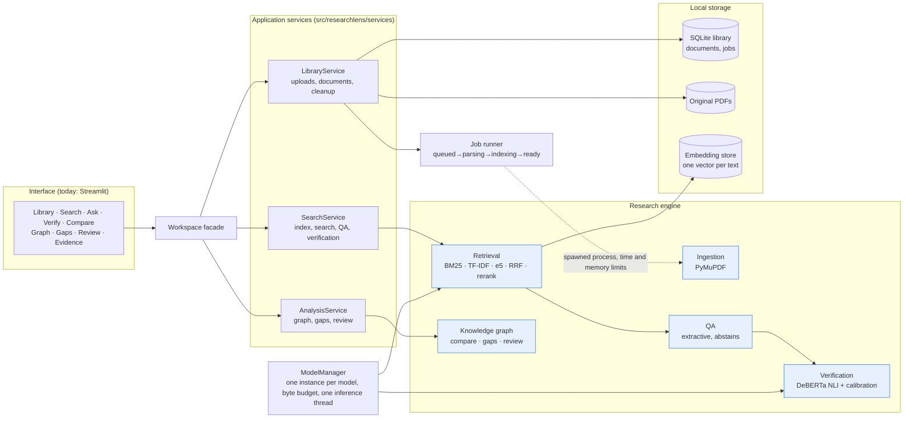
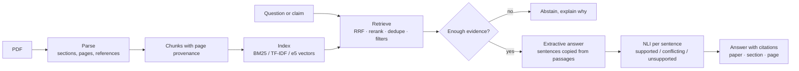
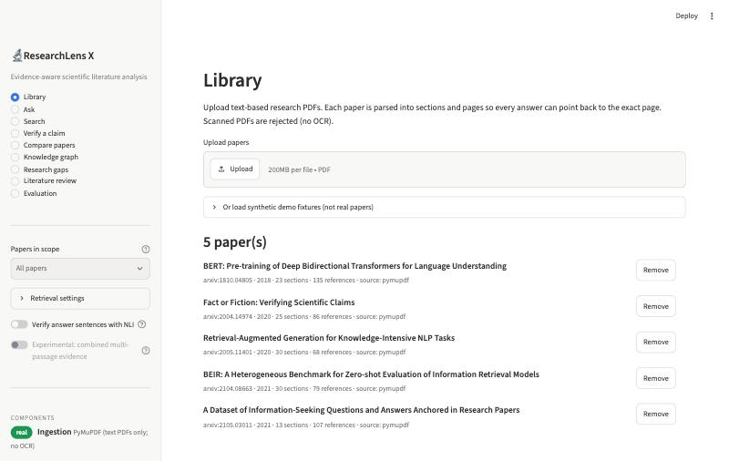
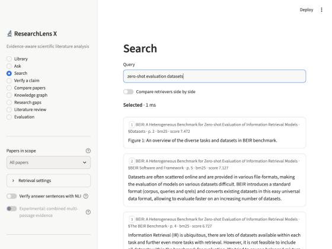
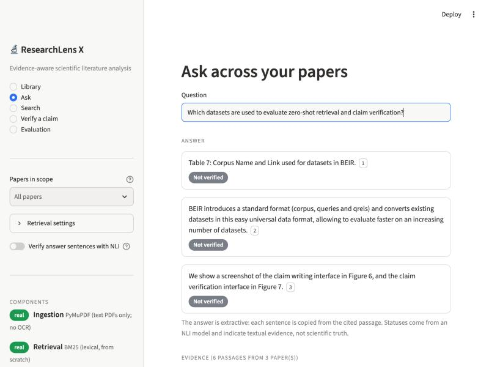
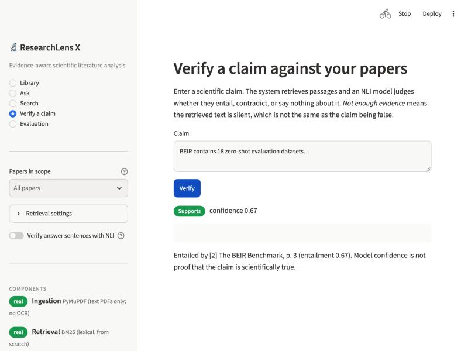
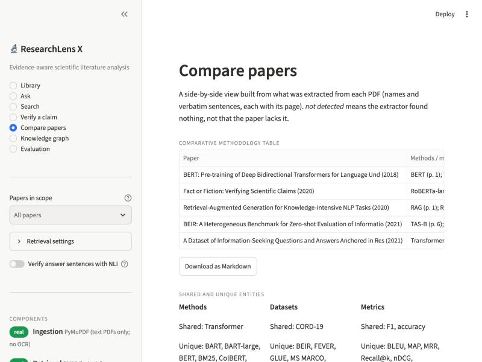
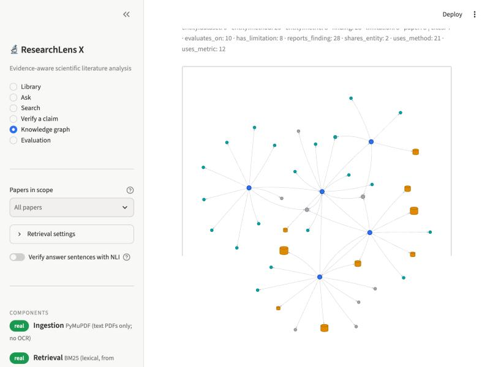
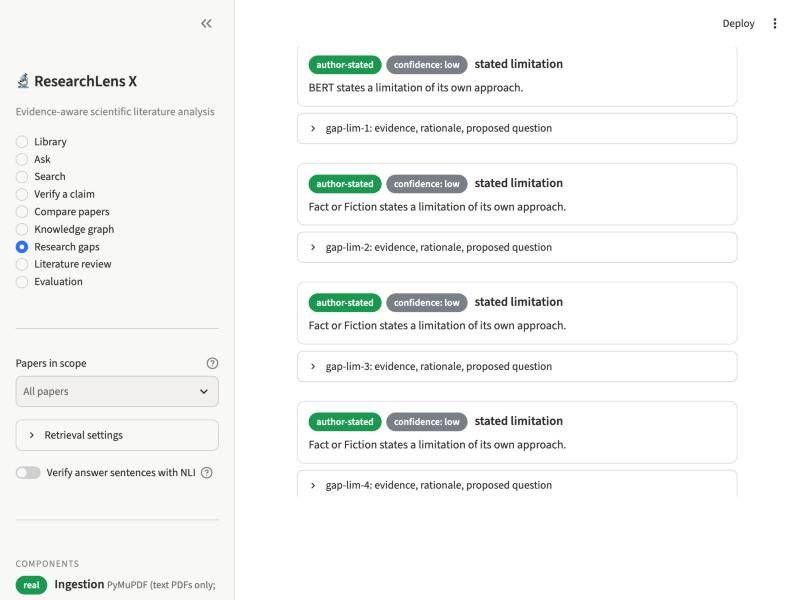
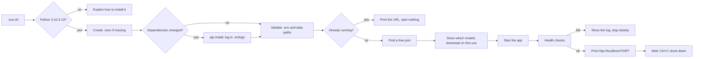

# ResearchLens X

**Scientific Research Intelligence Platform**
*An evidence-aware scientific intelligence platform for understanding, verifying and connecting research across multiple publications.*

[](https://github.com/sudo-pranshu/ResearchLensX/actions/workflows/ci.yml) · License: [AGPL-3.0-or-later](LICENSE) · Created and maintained by [Pranshu Kumar](https://github.com/sudo-pranshu)

---

## 1. What is ResearchLens X?

ResearchLens X is a local application and research framework for working with a collection of scientific papers. You give it PDFs; it parses them into sections and pages, lets you search across them, answers questions **with citations that point to the exact paper, section and page**, checks claims against the text with a natural-language-inference (NLI) model, compares papers, builds a provenance-grounded knowledge graph, lists **candidate** research gaps, and exports a cited literature review.

It runs on your machine. It needs no account and no API key, and it does not send your documents anywhere. **No text in the app is written by a generative model**: answers are sentences copied from the papers, and every statement keeps a pointer back to its source.

> **Status in one sentence:** the research engine is implemented, tested (189 tests) and evaluated; the current interface is a Streamlit app; a redesigned frontend and local API are planned (see [roadmap](docs/development/IMPLEMENTATION_ROADMAP.md)). Nothing is hosted online.

## 2. Why does it exist?

Reading a stack of papers to answer "which datasets do these use?", "do any of them disagree?" or "what is still open?" is slow, and the usual shortcuts have problems:

- **Keyword search** finds words, not evidence, and says nothing about whether a passage supports or contradicts a claim.
- **Generic chat-with-PDF tools** produce fluent text that can invent claims and citations, and rarely tell you when the papers simply do not contain the answer.
- **Citation graphs** show who cites whom, not what the papers actually found.

ResearchLens X takes a different position: **retrieve first, quote exactly, verify explicitly, and say so when the evidence is missing.** Every output is traceable to a passage; uncertainty (abstention, "not enough evidence", candidate relations, collection-scoped gaps) is shown instead of hidden. It also treats its own claims scientifically: hypotheses were pre-registered and tested, and the **negative result is reported** (see [section 9](#9-research-and-evaluation)).

## 3. What can it do?

| Capability | What you get | Status |
|---|---|---|
| **PDF ingestion** | text PDFs → title, abstract, sections, per-paragraph pages, references, arXiv id; duplicate detection; explained failures; originals stored | Implemented, tested |
| **Library** | persistent local library, filters, removal that also deletes stored files, background job model with limits | Implemented, tested |
| **Hybrid retrieval** | BM25, TF-IDF, e5 dense, hybrid RRF; optional cross-encoder rerank; redundancy suppression; section filters | Implemented; retrieval methods **evaluated**; rerank evaluated on the dev split only |
| **Evidence-aware QA** | multi-paper extractive answers, references with paper/section/page, evidence coverage, visible abstention | Implemented, tested |
| **Claim verification** | SUPPORTS / CONTRADICTS / INSUFFICIENT with explanation and calibrated confidence | Implemented; verifier **evaluated** (SciFact dev); calibration evaluated |
| **Paper comparison** | methods, datasets, metrics, findings, limitations, each cell with its quote and page | Implemented (extraction is rule-based) |
| **Knowledge graph** | papers, authors, methods, datasets, metrics, findings, limitations; provenance on every edge | Implemented; extraction audited informally |
| **Cross-paper relations (NLI)** | supports / contradicts between a finding and another paper | **Experimental**: gated, labelled *candidate* |
| **Research gaps** | author-stated, pattern-based and absence-based gaps with evidence and template questions; never claimed novel | Implemented; precision **not independently measured** |
| **Literature review** | structured, every sentence cited; Markdown, HTML and PDF export | Implemented, tested |
| **Combined multi-passage evidence** | several passages jointly supporting a claim | **Experimental**, uncalibrated |
| **Redesigned web frontend, local API** | modern UI over a local HTTP API | **Planned** ([specification](docs/architecture/UI_UX_SPECIFICATION.md)) |
| **Online hosting, accounts, OCR** | | Not planned now / not supported |

## 4. How does it work?



**What the diagram shows.** The interface only talks to a `Workspace` facade. Uploads become **jobs**: the original PDF is stored first, then parsed in a separate process with a time and memory limit (a hostile PDF cannot take the app down), then indexed; a document becomes *ready* only when it is part of the current index. Searches use **one index per library**, with a paper selection applied as a filter, so scoped and unscoped results come from the same snapshot. Neural models (e5, the reranker, the NLI verifier) are loaded once, on first use, by a `ModelManager` that keeps memory bounded and runs inference on one thread. Everything is stored locally.



More diagrams and a module-by-module description are in [docs/architecture/ARCHITECTURE.md](docs/architecture/ARCHITECTURE.md) and [docs/architecture/LOCAL_ARCHITECTURE.md](docs/architecture/LOCAL_ARCHITECTURE.md).

## 5. See it in action

Real screenshots of the current Streamlit interface (captured while developing; the navigation has since gained pages, and Review/Evidence screenshots are not included yet). The library holds five openly available arXiv papers; screenshots show short excerpts for illustration.

| | |
|---|---|
| **Library**: upload PDFs, see what was extracted per paper  | **Search**: BM25 here; every result shows paper, section, page and score  |
| **Ask**: extractive answer, citation chips, status pills and the evidence below  | **Verify a claim**: verdict, calibrated confidence, explanation, judged passages  |
| **Compare papers**: methods, datasets, metrics, findings, limitations with pages  | **Knowledge graph**: papers, methods, datasets, metrics; hover for the source quote  |
| **Research gaps**: basis, evidence, template question, collection-scope caveat  | |

A step-by-step demonstration is in [docs/user-guide/DEMO_WORKFLOW.md](docs/user-guide/DEMO_WORKFLOW.md).

## 6. Quick Start

```bash
git clone https://github.com/sudo-pranshu/ResearchLensX.git
cd ResearchLensX
./run.sh
```

**What `./run.sh` does.** It checks for a supported Python (3.10 to 3.13), creates `.venv` if missing, installs dependencies (the first run downloads roughly 1 to 2 GB, mostly PyTorch; later runs skip this), validates `.env` if you have one, picks a free port (8501 by default), starts the application, health-checks it (packages import, a tiny PDF is ingested and answered offline, the app answers) and prints the address. It starts **one** process: the interface and the research engine run together. There is no separate API, frontend server or database server yet. Ctrl+C stops everything.



Open **http://localhost:8501** (the launcher prints the actual address). Then:

1. On **Library**, upload one or more research PDFs (text-based; scanned PDFs are rejected with an explanation).
2. Try **Search** and **Ask**; open **Retrieval settings** in the sidebar to switch between BM25, TF-IDF, e5 and the hybrid, or to enable reranking.
3. Switch on **Verify answer sentences with NLI** or use **Verify a claim**.
4. Explore **Compare papers**, **Knowledge graph**, **Research gaps** and **Literature review** (export Markdown, HTML or PDF).

**Models.** BM25 and TF-IDF need no model. e5 (about 0.4 GB), the reranker (0.1 GB) and the NLI verifier (0.4 GB) are downloaded from the Hugging Face Hub the first time you use them; the launcher tells you which are already cached. With **`./run.sh --lite`** no PyTorch is installed and those features are unavailable (the app says so; it never fakes them silently, and a placeholder is labelled MOCK).

**Stop:** press Ctrl+C in the terminal, or `scripts/stop.sh` from another one. Run `./run.sh --detach` to start in the background.

**Optional commands** (not needed for normal use):

```bash
./run.sh --port 8600 --open     # preferred port, open the browser
make test                        # run the test suite (needs the .venv)
make docs                        # check Markdown links and wording
make health                      # environment and pipeline smoke test
./scripts/run_eval.sh            # reproduce the CPU experiments (--full adds the model-based ones)
```

**Troubleshooting**

| Problem | What to do |
|---|---|
| "No suitable Python found" | install Python 3.12 (`brew install python@3.12`, or `sudo apt install python3 python3-venv`) |
| Port already in use | the launcher moves to the next free port and prints it; or `./run.sh --port 8700` |
| Installation fails | read `.rlx/logs/setup.log`; check your connection; try `./run.sh --lite` |
| First NLI/e5 use is slow | the model is being downloaded and loaded once; watch `.rlx/logs/app.log` |
| App will not start | `.rlx/logs/app.log` shows why; `make health` runs the environment checks |
| Windows | native Windows is not supported; use WSL2 and run `./run.sh` inside it |
| Stop does not work | `scripts/stop.sh`, then `rm -rf .rlx` and start again |

## 7. How to use it

1. **Upload** papers. Each is validated (type, size, page limit), stored, parsed in an isolated process and indexed. Failures say why; identical files are reported as duplicates.
2. **Search** across the library or a selection of papers. Results are passages, each with paper, section, page, score and retriever.
3. **Ask** a question. You get sentences copied from the best passages, with `[n]` citations, an evidence list and a coverage measure. If nothing covers the question, the app **abstains** and shows the reason.
4. **Inspect citations**: every reference shows title, section and page ("page unknown" is shown when the PDF gave none).
5. **Verify claims**: enter a claim to see SUPPORTS, CONTRADICTS or INSUFFICIENT with the judged passages and an explanation; "not enough evidence" is not the same as "false".
6. **Look for conflict or missing evidence** through the per-sentence statuses (supported, conflicting, contradicted, unsupported).
7. **Compare** papers by methods, datasets, metrics, findings and limitations; "not detected" means the extractor found nothing, not that the paper lacks it.
8. **Explore the graph**; candidate (NLI) relations are visibly marked and every edge has a source.
9. **Examine research gaps**: collection-scoped candidates with evidence, caveats and template questions.
10. **Generate and export** a literature review (Markdown, HTML, PDF). Every statement carries a numbered citation.

## 8. Technical deep dive

| Module | What it does | Code | Notes |
|---|---|---|---|
| **PDF ingestion** | PyMuPDF text extraction, heading detection, per-paragraph pages, header/footer removal, de-hyphenation, references, arXiv id | `src/researchlens/ingestion/` | text PDFs only (no OCR); two-column and table text can be noisy |
| **Library and jobs** | SQLite (versioned, WAL), original files, job state machine, spawned parse worker, restart recovery | `store/`, `storage/`, `jobs.py`, `parse_worker.py` | one local worker |
| **Hybrid retrieval** | BM25 (from scratch), TF-IDF, LSA, e5 + FAISS, SPECTER2/SciBERT (experiments), RRF, cross-encoder rerank, redundancy suppression, section filters | `retrieval/` | in the app: BM25, TF-IDF, e5, RRF(BM25+e5), optional rerank; the rest are experiment-only |
| **Evidence-aware QA** | balance passages across papers, extractive sentences, reference construction, coverage-based abstention | `qa/engine.py` | the abstention signal is weak (AUROC 0.64); the NLI status is the stronger check |
| **NLI verification** | DeBERTa-v3 (MNLI, FEVER, ANLI), passage-level premises, temperature calibration, deterministic explanations | `verification/`, `evaluation/calibration.py` | calibrated confidence only for the validated passage-level setup |
| **Knowledge graph** | rule-based extraction with provenance, reference matching, TF-IDF similarity, shared entities, gated NLI links | `knowledge_graph/` | candidates are labelled; mocks never create relations |
| **Paper comparison** | table built from the graph, each cell citing its quote and page | `analysis/compare.py` | |
| **Research gaps** | author-stated limitations and future work, cross-paper patterns, method×dataset pairs never seen together | `analysis/gaps.py` | collection-scoped; **no novelty claim**; confidence capped at "medium" |
| **Literature review** | assembled from verbatim sentences; Markdown, HTML, PDF | `analysis/review.py` | |
| **Models and memory** | one instance per model, lazy loading, byte budget, single inference thread | `models.py` | |

Further reading: [architecture](docs/architecture/ARCHITECTURE.md), [local architecture](docs/architecture/LOCAL_ARCHITECTURE.md), [technical decisions](docs/architecture/TECHNICAL_DECISIONS.md), [repository audit](docs/development/REPOSITORY_AUDIT.md), [engine hardening results](docs/development/PHASE4_RESULTS.md).

## 9. Research and evaluation

Two hypotheses were pre-registered. Numbers below are real runs; configs, git hashes and per-question outputs are in [`results/`](results/README.md), and the full register is in [docs/research/PROJECT_BIBLE.md](docs/research/PROJECT_BIBLE.md) (section G).

| Experiment | Result |
|---|---|
| **H1: hybrid retrieval beats every single retriever.** QASPER **test** split (run once), Recall@5 | e5 **.501** · linear(BM25+e5) .496 · RRF(BM25+e5) .486 · LSA .430 · BM25 .415 · TF-IDF .382. RRF vs e5: Δ −.015 [−.032, +.002], p_holm .10. **H1 is not supported.** The hybrid beats the lexical baselines only. |
| Cross-encoder reranking, QASPER **dev** | Recall@5 .502 → .580 with the hybrid first stage (+.078, p_holm .0003). Dev only; no test run |
| NLI verifier, SciFact dev, macro-F1 | logistic regression .518 → DeBERTa passage-level .681 |
| Confidence calibration (dev, out-of-fold) | expected calibration error .183 → .067 |
| **H2: verified RAG improves citation correctness.** QASPER dev pilot, 100 questions, 1.5B generator | citation precision .420 → .785 on the 77 paired questions, **but answer F1 .286 → .225 fails the pre-set guard** (23% of answers abstain after unsupported sentences are dropped). **Partially supported on dev, not confirmed**; no test run |
| Abstention by lexical coverage | AUROC .636 for unanswerable questions: a weak signal |
| Knowledge-graph extraction (informal audit, 5 papers, one annotator) | methods about 76% precise; datasets 10/10 precise but low recall; raw cross-paper NLI edges 0/9 valid, so they are now gated and labelled candidates |

**Engine hardening (measured on an Apple M2, 8 GB, the 5 real papers):** adding one paper to an e5-indexed library takes 1.5 s instead of 10.9 s (only its 133 new chunks are embedded); uploading through the isolated job queue is about 2 s slower for 5 files than inline parsing (the price of isolation). Details in [PHASE4_RESULTS.md](docs/development/PHASE4_RESULTS.md).

**Honest limitations** (full list: [KNOWN_LIMITATIONS.md](docs/user-guide/KNOWN_LIMITATIONS.md)): ingestion handles text PDFs only and reference counts are approximate; answers are extractive, so they are traceable but not fluent prose; the NLI model is one model used out of domain; research-gap quality and rule thresholds were tuned on five papers, so apparent quality is optimistic; most results are on the development split; the 7–8B-generator run, test-split runs for rerank and H2, the H1 ablations and independent gap labelling were **not** performed.

**Reproduce:** `./scripts/run_eval.sh` (tests and CPU experiments) and `./scripts/run_eval.sh --full`; datasets are downloaded by `scripts/download_*.sh`. Dataset licences: QASPER CC BY 4.0, SciFact CC BY-NC 2.0. See [licences and third-party notices](docs/user-guide/LICENSES.md).

## 10. Contributing, licensing and citation

- **Contributing:** see [CONTRIBUTING.md](CONTRIBUTING.md) (principles: no fabricated results, mocks are labelled, traceable outputs, honest scope). Run `python -m pytest -q` and `python scripts/check_docs.py` before a pull request. Please follow the [Code of Conduct](CODE_OF_CONDUCT.md); report vulnerabilities privately per [SECURITY.md](SECURITY.md).
- **Licence:** [AGPL-3.0-or-later](LICENSE), chosen because the PDF parser PyMuPDF is AGPL; reasoning, dependency, model and dataset licences in [docs/user-guide/LICENSES.md](docs/user-guide/LICENSES.md).
- **Privacy and security:** documents and derived data stay on your machine; the only network access is downloading model weights from the Hugging Face Hub on first use. The app has **no authentication**: do not expose it to an untrusted network.
- **Citation:** see [CITATION.cff](CITATION.cff) (GitHub shows a "Cite this repository" button).
- **Creator and maintainer:** Pranshu Kumar ([@sudo-pranshu](https://github.com/sudo-pranshu)). ResearchLens X has no affiliations, partnerships or endorsements to declare.
- **Project documents:** [changelog](CHANGELOG.md) · [state](docs/development/PROJECT_STATE.md) · [roadmap](docs/development/IMPLEMENTATION_ROADMAP.md) · [release plan](docs/development/RELEASE_PLAN.md).
