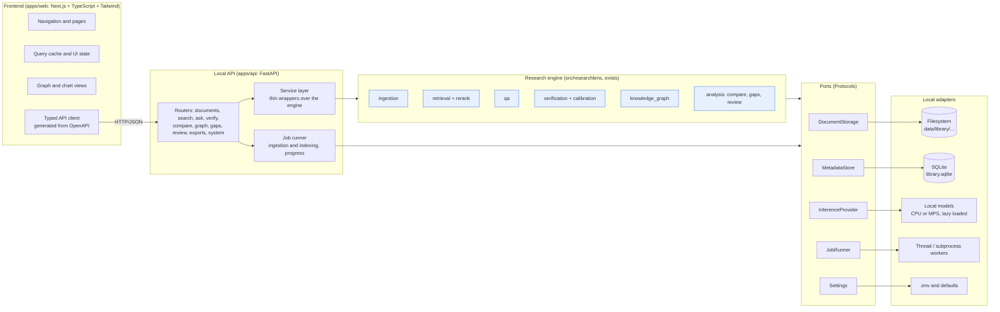

# Local architecture (target)

Status: **approved 2026-11-14; Phase 4 (engine hardening) implemented** (see `docs/development/PHASE4_RESULTS.md`): settings, versioned store, storage port, model manager, per-text embeddings, index generations, job runner, services. Still to build: the HTTP API with the §11 protections, the frontend, the awaitable `InferenceProvider`. Scope: a complete local application, no cloud services; every boundary that a later online deployment would need is an interface with a local implementation (see `docs/deployment-readiness/FUTURE_DEPLOYMENT_READINESS.md`).

## 1. Logical structure
`Frontend → Local API → Research engine → Storage / Models`

Blue = exists today (about 4,200 lines, 133 tests). Everything else is new work. The engine never imports the API or the frontend.

## 2. Components and responsibilities
| Layer | Responsibility | Must not |
|---|---|---|
| `apps/web` | pages, navigation, state, visualisation, upload interactions, accessibility, themes | contain scientific logic, scoring, extraction or any hard-coded metric |
| `apps/api` | HTTP contract (Pydantic, OpenAPI), validation, job orchestration, error mapping, exports | reimplement engine behaviour; hold business rules beyond orchestration |
| `src/researchlens` | all scientific functionality and its tests | import FastAPI, Next.js, filesystem layout or cloud SDKs directly |
| Ports | narrow interfaces for storage, metadata, inference, jobs, settings | leak adapter details upward |
| Adapters | local implementations (filesystem, SQLite, local models, thread/subprocess workers, env settings) | be referenced from the engine except through ports |

## 3. Process model (one command)
`./run.sh` (exists for the Streamlit app) is extended to:
1. check prerequisites (Python 3.10-3.13; **Node 20+** for the frontend build, detected and explained if missing);
2. create `.venv`, install Python dependencies, run `npm ci` for `apps/web` only when the lockfile changed;
3. build the frontend once (`next build`, static export) when sources changed;
4. start **one Python process**: Uvicorn serving the API under `/api` **and** the built frontend as static files on a single port (default 8501, next free port if taken), so users need no second terminal and there is no CORS;
5. run health checks (`/api/health`, engine smoke test) and print the URL; Ctrl+C stops everything.
Developers use `make dev`: Uvicorn with reload plus `next dev` with proxying to the API (HMR). **Decision to confirm:** serve the static export from the API (recommended: fewer processes, simpler startup, deployable later as a static site) versus running `next start` as a second process (supports server-side rendering, which this app does not need).
Until the new UI passes the end-to-end suite, the Streamlit app remains the default so the product never regresses.

## 4. API (first version)
All endpoints are scoped by an implicit workspace id (`local` today) so later per-user scoping is a parameter change. JSON models are Pydantic classes exported to OpenAPI, from which the TypeScript client is generated.
| Area | Endpoints | Notes |
|---|---|---|
| System | `GET /api/health`, `GET /api/status` (components real / fallback / mock / off, models cached or not, memory), `GET /api/config` | status mirrors `Workspace.status()` |
| Documents | `POST /api/documents` (multipart, many files → job per file), `GET /api/documents` (filters: status, year, text), `GET /api/documents/{id}`, `DELETE /api/documents/{id}`, `GET /api/documents/{id}/pdf` | original PDF stored; deletion removes file, rows, caches |
| Jobs | `GET /api/jobs`, `GET /api/jobs/{id}` (state, stage, progress, error reason), `POST /api/jobs/{id}/retry` | states `queued → processing → ready / failed`; Server-Sent Events later if polling is insufficient |
| Search | `POST /api/search` (query, retriever, rerank, sections, doc scope, k) | returns passages with doc, section, page, score, retriever, latency |
| Ask | `POST /api/ask` | answer sentences, statuses, references, evidence coverage, abstention reason, timings, is_mock |
| Verify | `POST /api/verify` | label, calibrated confidence flag, explanation, evidence judgements, `experimental` flag |
| Compare | `POST /api/compare` | table cells with quotes and pages, shared/unique entities |
| Graph | `POST /api/graph` | nodes, edges with provenance and `status` (extracted, measured, candidate) |
| Gaps | `POST /api/gaps` | gaps with basis, evidence, template question and methodology, scope note |
| Review | `POST /api/review`, `GET /api/review/{id}/export?format=md|html|pdf` | cited review, sources list |
| Results | `GET /api/results`, `GET /api/results/{experiment}` | committed experiment summaries, read-only |
Long operations (ingestion, first indexing, graph with NLI) are jobs; fast operations are synchronous with timeouts and typed errors (`ModelUnavailable`, `InsufficientEvidence`, `DocumentFailed`, `Validation`).

## 5. Persistence
- **Structured data: SQLite** (already used by `CorpusStore`), WAL mode, schema migrations by version number. New tables: `documents` (adds `status`, `error`, `sha256`, `pdf_path`, `bytes`, `pages`, `added_at`), `jobs`, `settings`, `index_state`. Transactions wrap every multi-row change; foreign keys cascade on delete.
- **Files:** `data/library/<workspace>/<sha256-prefix>/original.pdf` written atomically (temp file + rename); deduplication by content hash before parsing; deletion removes the directory and all derived rows and caches.
- **Embeddings and indexes (fixes audit A2/A3; amended after the architecture review, §12):** do **not** persist FAISS or BM25 (BM25/TF-IDF statistics are corpus-wide, FAISS removal renumbers rows, and the first-query cost is mostly model load). Persist **per-document artefacts**: chunk embeddings in an `embeddings(encoder_key, text_sha256, vec BLOB)` table (content-addressed, keyed by the exact index text, shared entries removed by garbage-collection sweep, never by document deletion) and per-chunk term counts. An **index generation** is an immutable snapshot (ordered chunk ids + encoder key + chunker version) rebuilt in memory from the artefacts (about 12 MB of vectors for 20 papers, milliseconds) and swapped atomically; searches keep the snapshot they started with. A full rebuild and an incremental update run the same code, so results are identical by construction. The existing corpus-keyed `EmbeddingCache` stays unchanged for experiments (committed provenance depends on it).
- **Identity:** `doc_id` (arXiv id or content hash) is the canonical key; files are stored by `doc_id`, `sha256` is a column. A new PDF version of the same arXiv paper is reported as a duplicate of that id instead of leaving an orphan file.
- **Recovery and integrity:** a startup check compares `documents` rows with files on disk and re-queues or flags mismatches; failed jobs keep their error text; `PRAGMA integrity_check` available from `scripts/healthcheck.sh`; backups are plain copies of `data/` (documented).
- Why not a server database: single-user local use does not need one; the `MetadataStore` port lets a hosted relational database replace SQLite later.

## 6. Models and performance
Measured baseline is in `docs/development/REPOSITORY_AUDIT.md` §3. Plan:
| Topic | Design | Measured before and after (acceptance) |
|---|---|---|
| Lazy loading and memory | a `ModelManager` owns **one instance per model id** (today every engine/scope builds its own copy: audit A6), loads on first use under a lock, runs all inference on one dedicated executor thread, enforces a **byte budget** (not a model count) with least-recently-used unloading, bounds the query and rerank caches, and receives the verifier **per call** (today `ask()` mutates a shared verifier) | peak RSS with all three features used across scopes in one session; model loads happen exactly once |
| Device | CPU default, MPS on Apple silicon when it is faster for batch encoding (measured per model), no GPU assumption | e5 encode time per 100 chunks on CPU vs MPS |
| Embedding cache | per-chunk hash (audit A2) | time to add one paper to a 20-paper library: before (full re-embed) vs after |
| Index generations | one library-wide index rebuilt from persisted artefacts; scope applied as a `doc_ids` candidate filter | first query after restart; search results identical to a fresh build |
| PDF processing | parse in a subprocess with timeout and memory limit; batch jobs sequentially | seconds per paper at 1, 5, 20 papers |
| Concurrency | one worker for CPU-bound jobs, a request thread pool for fast reads; per-model lock | latency of search while an upload job runs |
| Frontend | route-level code splitting, virtualised lists, canvas-based graph, memoised queries | Lighthouse performance and interaction timings on a 20-paper library |
No improvement is reported unless measured on the same machine with the same corpus.

## 7. Configuration (environment-based)
Central `researchlens.settings` (Pydantic settings, `.env` supported; `RLX_DB` stays as an alias). Backend-selection switches are not added until a second adapter exists: one Protocol plus a constructor is enough. No path, credential or provider name appears elsewhere.
| Variable | Default | Meaning |
|---|---|---|
| `RLX_DATA_DIR` | `./data` | root for library files, database, caches |
| `RLX_DB` | `{RLX_DATA_DIR}/processed/library.sqlite` | SQLite metadata store (a database URL replaces it when a hosted database exists) |
| `RLX_FILES_DIR` | `{RLX_DATA_DIR}/library` | original PDFs |
| `RLX_EMBEDDING_DIR` | `./artifacts/embeddings` | embedding stores |
| `RLX_WORKSPACE` | `local` | workspace id scoping all stored data |
| `RLX_HOST`, `RLX_PORT` | `127.0.0.1`, `8501` | bind address and preferred port |
| `RLX_MAX_UPLOAD_MB`, `RLX_MAX_PAGES` | 50, 400 | upload limits (defaults to be validated) |
| `RLX_DEVICE` | `auto` | `cpu`, `mps`, `auto` |
| `HF_HOME` | Hugging Face default | model cache |
`.env.example` lists exactly the variables that exist.

## 8. Repository mapping (target vs plan)
| Target | Plan | Reason |
|---|---|---|
| `researchlens/` at root | stays **`src/researchlens/`** | src layout is standard; moving would change import resolution and tooling with no user benefit. Sub-packages named as in the target (`ingestion`, `retrieval`, `qa`, `verification`, `knowledge_graph`, `analysis`, `evaluation`); `comparison` stays inside `analysis/compare.py` unless it grows |
| `apps/web`, `apps/api` | new | frontend and API |
| `apps/streamlit` | exists | legacy UI until parity, then archived |
| `infrastructure/local` | new, only when real files exist (launcher helpers, an optional Dockerfile that has been built and tested) | no empty placeholders |
| `experiments/{configs,notebooks,results}` | `experiments/notebooks` done; **`configs/` and `results/` stay at the root** | committed provenance (`config.json` records paths and git hashes) and the register reference them; moving breaks reproducibility. Revisit only with a path-migration tool |
| `tests/{unit,integration,e2e}` | split by directory, flat helpers kept importable | existing imports (`tests.test_ingestion`) must keep working |
| `docs/{architecture,research,development,user-guide,deployment-readiness}` | done | |

## 9. Testing strategy
Existing 133 tests stay green. Added: API tests (FastAPI `TestClient`, temp data dir, hostile PDFs), integration tests (upload → job → search → ask → verify → export), frontend unit tests (Vitest + Testing Library), accessibility checks (axe), browser end-to-end tests (Playwright against `./run.sh`), startup tests (clean clone, port conflict, restart persistence), error-state tests (model unavailable, failed PDF, abstention, MOCK banner).

## 10. Scientific-honesty contract carried through the API
Typed fields the UI must render and tests must verify: `is_mock`, `experimental`, `calibrated`, `status` (extracted / measured / candidate), `scope` ("collection-only") on gaps, `abstained` with a reason, `page` possibly null ("page unknown"). The frontend contains no metric literals; evaluation numbers come from `/api/results`.

## 11. Security of the local API (added after the review)
A server on `localhost` is reachable by **any web page open in the user's browser**. A multipart upload is a "simple" cross-site request, and DNS rebinding can make a hostile domain read the API. Required from the first API commit:
- bind to `127.0.0.1`; refuse `RLX_HOST=0.0.0.0` unless authentication is enabled;
- `TrustedHostMiddleware` allow-list (`localhost`, `127.0.0.1`) for the exact served port; no CORS middleware (development uses the `next dev` proxy);
- every non-GET request must carry `Origin` equal to the served origin, `Sec-Fetch-Site: same-origin`, and a per-launch token header (delivered to the page by a SameSite=Strict cookie on index load);
- the size limit is enforced **while streaming** the upload, and the page count is checked before parsing; PDF and HTML-export responses use `X-Content-Type-Options: nosniff`, `Content-Disposition` and a strict CSP;
- if the preferred port is taken, the launcher prints the new origin and the API's origin checks bind to the port it was actually started on (the origin is part of the security boundary).

## 12. Architecture review log
Independent review (Opus, 2026-11-14, read-only, recorded in the ledger) found six issues, all accepted:
| # | Finding | Resolution in this document |
|---|---|---|
| R1 | incremental BM25/FAISS cannot match a full rebuild; persisted FAISS does not remove the first-query cost | per-document artefacts + immutable index generations (§5) |
| R2 | per-chunk cache vs document identity: shared entries, orphan files, split identity | content-addressed embeddings table with GC; `doc_id` canonical (§5) |
| R3 | models are duplicated per scope/engine; shared verifier mutated by `ask()`; unlocked loads; unbounded caches; torch + thread-pool crash risk (`_runtime.py` workaround) | `ModelManager` (one instance per model, single inference thread, byte budget, per-call verifier) (§6) |
| R4 | jobs vs a single SQLite connection; macOS fork and `RLIMIT_AS` limits; indexing is library-wide; inconsistent state machines | parse = pure function in an isolated `python -m` subprocess (only the API process writes; multiprocessing `spawn` was rejected after it failed when the parent's `__main__` is not a file); RSS polling for limits; one serialised "rebuild generation" job (a document is `ready` only once it is in a generation); one state machine (`queued → parsing → indexing → ready / failed / cancelled`); cancel and retry endpoints; re-queue `processing` jobs on startup; original stored before enqueue |
| R5 | no protection against browser-based attacks on the local API | §11 |
| R6 | ports too thin for hosting | **explicit** `workspace_id` argument on `MetadataStore`, `DocumentStorage`, `JobRunner`; `DocumentStorage` gains stream-open and presigned-URL methods; batch-shaped, awaitable `InferenceProvider` keyed by model and revision; idempotency keys for uploads and jobs; request settings kept separate from process settings; SPA fallback routing for deep links |
Deferred as over-engineering: persisted FAISS/BM25, MPS-versus-CPU measurement for every model, backend switches, Server-Sent Events, Lighthouse thresholds in the engine phase, `/results` before the core flow works, the tests directory split before an API exists, a migration framework (use an integer `user_version` and ordered SQL files).
